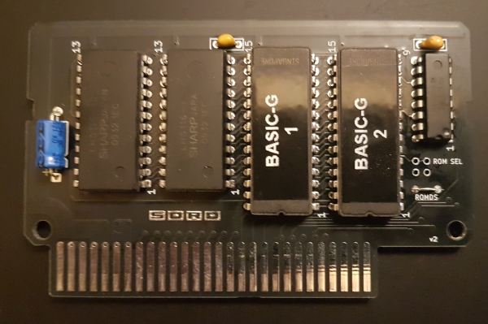

# M5E-00 v2

A replica of the common M5E-00 cartridge board found in BASIC-G and many games, which may or may not need the RAM. Super Cobra for example runs as a single 8K ROM with no RAM.

The common factory bodge of a 1nF capactor on /RD has been included at position C3.

It takes 2 6116 RAM chips addressed by the on board 74LS139 and two 2764 ROMs. Many BASIC and game images found online have been concatenated to 16K so will need splitting to fit back on this board.