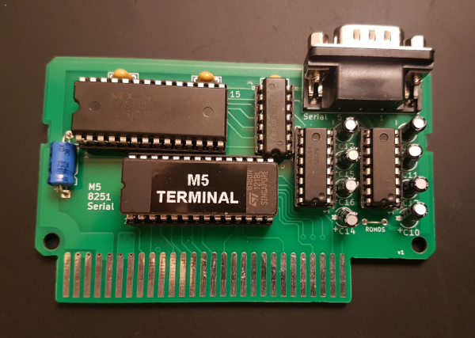

# M5Serial8251 v2

	
A simple serial interface combining various schematics using the 8251 chip and MAX232 drivers. Compatible with M5 Terminal ROM.

It seem thats this board doesn't half the baud rate as M5 Terminal expects, which is partially beneficial as 600 baud, the maximum data rate becomes 1200 baud on the wire.

### M5 Sample Operation

Press space twice to enter setup. Pressing Return changes entries. Space moves on. The following entries were used during testing:

Code Type: JIS 8 
Parity:	No 
Stop Bit: 1 
Baud Rate: 600 
Mode: Ignore 
Output: CRT 
Duplex: Half 
Terminal Xon/Xoff: No 
Host Xon/Xoff: No 
Auto Newline: No 
Hard Copy: No 
 
As noted above, 600 baud became 1200 baud on the wire.