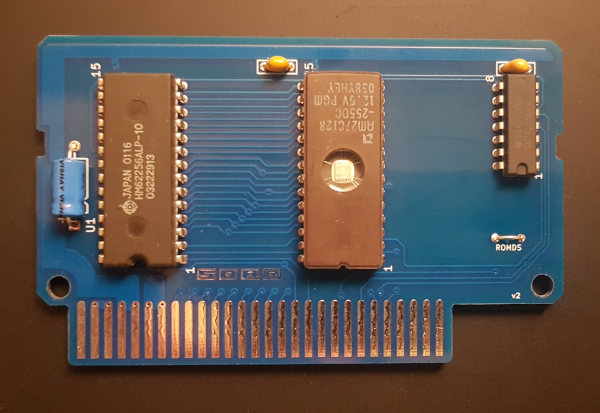

# SROM32K v2

A modified version of the M5E-00 cartridge board with a 62256 32K RAM chip replacing the 6116 RAM on board and a single 16K ROM chip (27128), signals combined with a 74LS86. Suitable for single 16K ROM image requiring or capable of using 32K RAM.
