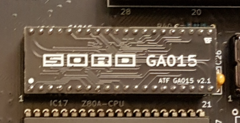

# ATFGA015 v2.1

A SMD GA015 gate array replacement using the ATF1502 and a 74LS32 that fits within the DIP-40 footprint, chips mounted on the underside. This requires experience of programming an ATF CPLD chip.

## Programming

The PLD file can be compiled in WinCUPL or WinCUPL II, available from the [Microchip website](https://www.microchip.com/). The generated JED file can be converted into an SVF file, either with ATMISP (also available from Microchip) or with the [fuseconv](https://whitequark.github.io/prjbureau/tools/fuseconv.html) tool from [prjbureau](https://github.com/whitequark/prjbureau).

This can be either programmed using the 6 labelled 2mm pitch pogo pin pads on the base of the board or using the ATFGA015Prog board though the DIP pins, plus a larger VPP pad for reprogramming if required. See ATFGA015Prog folder for notes on programming. Typically programmers do not provide power which still needs injecting if using the pads.

Keep in mind that this design reuses the JTAG pins, so after the first programming you need to provide 12V VPP to erase and reprogram the chip.

## Code

Code by Jens Restemeier can be found in the ATF folder.
