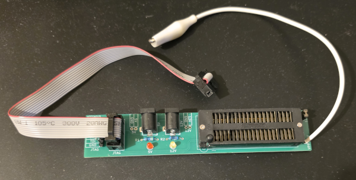

# ATFGA015Prog v1.1

An adapter board for a DIP-40 ZIF socket, power and JTAG headers for convinience of programming a built, unprogrammed board.

If programming goes wrong for whatever reason, the ATF1502 needs it's VPP pin raising to 12V during programming as an erase function to re-program. This is the fly-lead which connects to the large pad on the bottom of the ATFGA015 - careful not to scratch the board or the tracks. You don't need this if you get it right everytime, first time programming a blank chip requires 5V only.

If you need 12V VPP, the recommended process is to first apply 5V, then 12V, program, remove 12V and remove 5V.

## Programming

There are going to be many ways of doing this, with many different programming adapters. A openocd with um232h works fine - we've used this command succesfully on a Pi as an example:

openocd -f /usr/share/openocd/scripts/interface/ftdi/um232h.cfg -f atf1502.cfg -c "adapter speed 450" -c "transport select jtag" -c "init; svf sord-GA015.svf; exit"

The file atf1502.cfg was used:

jtag newtap auto0 tap -irlen 3 -expected-id 0x0150203f