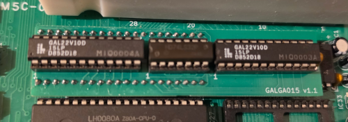

# GALGA015 v1.1

A GAL based GA015 gate array replacement using a pair of GAL22V10 chips with a 74LS32 chip. A minipro or equivalent can be used for programming the GALs.

## Code

Code by Jens Restemeier can be found in the GAL folder for each GAL22V10 chip, one for MEM and one for IO.