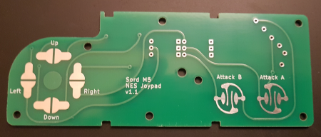

# M5JOYPADNES

Joypad Board for the Sord M5 to fit a NES-004E Case.

After some thought and an experimental board using 6mm push switches, which turned out badly, this happened - a board to replace the board out of an original NES-004E joypad to convert it for use for the Sord M5.

It only requires 6 1N4148 diodes and a 6 pin mini-din cable which can be found on AliExpress pre-wired at the plug end. Be warned, the ones found and ordered from AliExpress to test this with had the colour coding labelled backwards from the Ali description, and the colour labelling on the rear of this board matches the corrected pin layout of the ones delivered.

If in doubt use the pin numbering instead.

The contacts have been kept as front paste layers so a stencil could be made and appropriate goop applied and set for better contact, but it's playable with HASL as is. Haven't tried with ENIG, might be better.