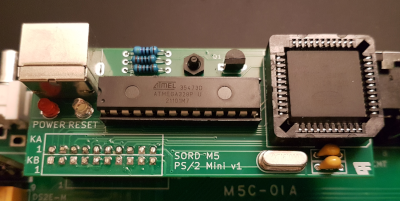
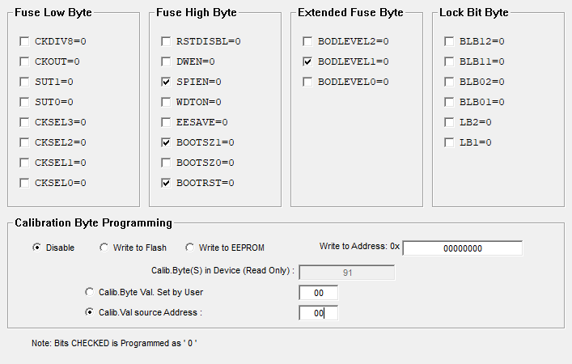

# M5PS2Mini v1

An ATMEGA328P based PS/2 keyboard interface. This is a miniaturized, tidied version of M5PS2 just with the ATMEGA328P. This uses the MT8816AP1 PLCC44 switch chip in a through hole socket to simulate the original keyboard.

This can be connected to the mainboard either as an overlay with a pin header plug e.g. a PC104 connector or through an IDC ribbon cable through pin headers at both ends.

## Code

Please see M5PS2 folder for more information about the code.

The build folder contains the build code which can be programmed to the chip with a Minipro with the following settings.

