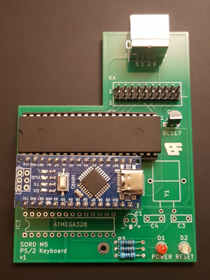

# M5PS2 v1

An Arduino based PS/2 keyboard interface with sockets for both a full Arduino Nano or an ATMEGA328P. This was intended as a development board - there is a second mini version of this board with the 328 only which may be more appropriate if you don't intend to modify the code. It uses the DIP-40 MT8816 switch chip to simulate original keyboard. These are easily found on AliExpress.

This can be connected to the mainboard either as an overlay with a pin header plug e.g. a PC104 connector or through an IDC ribbon cable through pin headers at both ends.

The oscillator circuitry doesn't need populating if using the Nano only as pictured. Don't populate the Nano and the ATMEGA328P at the same time.

## Code

The Arduino folder contains the code and can be loaded with Arduino IDE. This is based on C64Keyboard by Robert VanHazinga. Key mappings can be found in keymapping.h. This code can be used for the M5PS2Mini board the built binaries for which are in the build folder.

