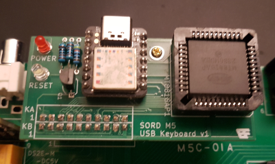

# M5USB v1

A XAIO SAMD21 based USB keyboard interface. A USB-C to USB-A adapter may be required for a regular keyboard. This uses the MT8816AP1 PLCC44 switch chip in a through hole socket to simulate the original keyboard. These are easily found on AliExpress.

This can be connected to the mainboard either as an overlay with a pin header plug e.g. a PC104 connector or through an IDC ribbon cable through pin headers at both ends.

## Code

The Arduino folder contains the code and can be loaded with Arduino IDE. This is based on C64Keyboard by Robert VanHazinga. Key mappings can be found in keymapping.h.

