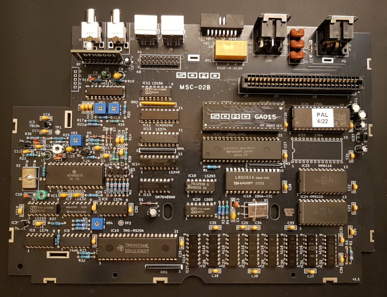

# M5C-02B

## Build Notes

Also see main page build notes.

IC34 - 78L05 is very vulnerable if not socketing chips 
C2 - Fit a narrow capacitor as HB001 gets in the way 
IC7 - TI 74LS132 originally. With an OnSemi part, R31 needed changing to 330R to make VR4 adjust the picture width correctly 

## Adjustment Trimmers and Pots

To follow