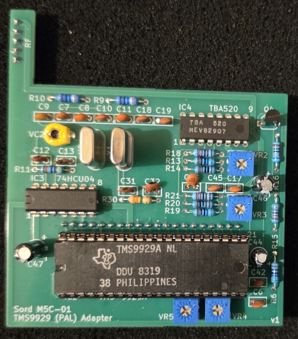

# M5TMS9929Adapter v1

An experimental PAL Adapter to allow the use of a TMS9929 on the M5C-01 NTSC board for PAL colour output. It provides the CPU clock and PAL colour encoding. 

IN NO WAY NEEDED AND NOT COMPATIBLE WITH THE M5C-02 (PAL) BOARD.

The PAL circuit is based on that found in the PAL SVI-728 using the TBA520 chip. It's difficult to tune, but it does work.

It plugs into the VDP socket instead of the TMS9918 and RF modulator header for 12V power.
