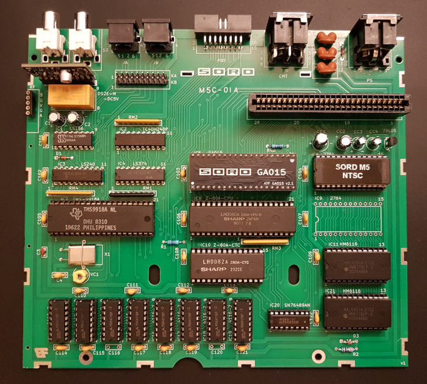

# Sord M5

Repository for the 2026 Board Folk recreation of main board variations, the gate array and cartridges of the Sord M5 Computer.

This repository contains the Bill-of-Materials (iBOM), Gerbers and Kicad files for remakes of the Sord M5 M5C-01A (NTSC) and M5C-02B (PAL) main boards, substitutes for the GA015 gate array and HB001 daughter board, cartridge boards and a collection of simple expansion boards to help use it.

Projects are in Kicad 10.

## General Overview

  * Z80 CPU
  * Z80 CTC
  * GA015 gate array for addressing and 2 data bit latches
  * 4K System RAM (onboard)
  * 16K Video RAM
  * 8K System/Monitor ROM (onboard)
  * 8K Expansion ROM (onboard, typically unpopulated)
  * SN76489(A)N Sound Chip
  * Printer Interface
  * Cassette (CMT) Interface
  * Cartridge Slot
  
### Cartridge Slot

Power passes through the cartridge header and as a result, the board won't power without a cartridge inserted. There is no BASIC included on the main board and a number of different BASIC cartridges were made available, most tapes requiring the BASIC-I or BASIC-G cartridge to load. The BASIC-G cartridge includes an extra 4K RAM. There's no key in the cartridge socket so it's possible without a case to plug in the wrong way round which would result in damage, but the overhang to one side should be relatively obvious - the cartridge fits entirely above the board.

There are many games and application cartridges, some of which include up to 32K RAM as standard. Some community expansions provide more than this.

### HB001

Required. A daughterboard sits between the board and a number of the ports. It provides composite video output conversion, switching for the tape relay and printer port, and level conversion for tape in and out. We've created a replica of the original as this was a sealed unit and it would have meant destroying one to reverse engineer it. An approximation as been made in BFHB001, of which there are two versions, one through hole (v0) and one SMD (v1). To note, these are fitted in the opposite orientation between the M5C-01A and M5C-02B main boards. Check orientation, it's marked either side.

### Power

Power is provided by a 6 pin DIN jack on the back of the board and requires 5V, 12V and -12V DC.

|PIN|Voltage|
|:--:|:--:|
|1|GND|
|2|GND|
|3|+5V|
|4|+12V|
|5|-12V|
|6|+5V|

To repeat, the mainboard doesn't power without a cartridge.

## Modifications

Any factory modifications were included on the board. One common non-factory modification, R40 was added, the insertion of a resistor between the gate array /ROM0 select and the rest of the board and cartridge to allow the cartridge to override that to allow for fuller addressing by the cartridge. Fit 0R for original operation or typically 360R for alternative use. This doesn't affect normal operation. Operation of this isn't covered by this repository as we're unfamiliar with what can be done with this. It seemed worth including.

Additions to the footprints were made for the RCA jacks as the original Hosiden part is very difficult to get hold of. The RCA-105A is the new recommended part on the remake boards, though a regular RCA-105 will fit, it's pretty bad as it's only stabalised in one direction and adding holes to the footprint to change this would make the jack too low for the case. The Switchcraft PJRAN1X1U01X may also fit, but we haven't tried.

### Differences between NTSC and PAL boards

The NTSC board is much smaller mainly due to having simpler clocks and no colour encoder. Composite video provided by the TMS9918 passes through the HB001 to the RCA jack. The PAL board uses two Hitachi chips which are now difficult, but not impossible to get hold of. The HD44007A provides the clock, /WAIT and sync timing and the HA11720 the PAL colour encoding.

The PAL and NTSC boards use different system ROMs which isn't clear online. The ROM found on archive.org is the PAL version and won't work on the NTSC board due to the PAL system triggering sync timing on the VDP through the RESET/Sync pin. The VDP doesn't initialise correctly with that on the NTSC board.

## Main Boards

### M5C-01A

As far as we're aware this was the second of three NTSC main boards for the Sord M5 in it's original/pro form. It uses the TMS9918 VDP and doesn't require any colour video encoding.

The later B revision board we're still trying to locate and complete, but at this time don't have one that's available in desoldered form to scan. It's fully functional as it includes the factory bodges to the joystick sockets and we don't believe the schematic to be any different, just slight changes to the the track and component layout.

### M5C-02B

This is the larger PAL board with the Hitachi chips described above. There are a number of potentiometers and trimmer capacitors for adjusting the clocks and colour output on the board that need adjusting that we'll try and document in due course.

As far as we're aware this is the final release of this board.

## Substitute Parts

May add to this in time

|Part|Substitute|Notes|
|:--:|:--:|:--:|
|TC40H240|74F240||
|1SV55|MV104|M5C-02B Only|

## Build Notes

Any decoupling caps at the bottom of either of the mainboards marked not-fitted aren't fitted on the original boards due to the RF shield. Similarly, a metal bar runs along the base of the original keyboard which prevents many of the lower chips being fitted in sockets.

## Gate array

The original GA015 gate, a DIP-40 package is near impossible to get hold of, so a replica was needed. Jens Restemeier (@jensrestemeier) recreated the logic, and there are two versions.

### GALGA015

The initial version for a pair of GAL22V10 chips with a 74LS32 as a throughhole option. A minipro or equivalent can be used for programming the GALs.

### ATFGA015

A neater SMD version for the ATF1502 that fits within the DIP-40 footprint, chips mounted on the underside. This requires experience of programming an ATF CPLD chip - we've used openocd. The board includes 6 labelled pads to program with a pogo pin clip if suitable with a separate larger VPP for a +12V supply for blanking the chip if programming goes wrong. We've also made an adapter board to help the process, ATFGA015Prog below.
 
### ATFGA015Prog

An adapter board for a DIP-40 ZIF socket, power and JTAG headers for convinience of programming a built, unprogrammed board (5V only), or reprogramming a board with VPP injection via a clip (requires 12V also).

## Keyboard

We're still working on a keyswitch keyboard, keycaps being the difficult part. In the interim, there are PS/2 and USB adapter boards, which may suit better anyway.

### M5PS2

An Arduino based PS/2 keyboard interface with sockets for both a full Arduino Nano or an ATMEGA328P. This was intended as a development board for the M5PS2Mini.

### M5PS2Mini

An ATMEGA328P based PS/2 keyboard interface.

### M5USB

A XAIO SAMD21 based USB keyboard interface. A USB-C to USB-A adapter may be required for a regular keyboard.

## Cartridges

### M5E-00

A replica of the common M5E-00 cartridge board found in BASIC-G and many games.

### DUALROM32K

A modified version of the M5E-00 cartridge board with a 62256 32K RAM chip replacing the 6116 RAM on board. Suitable for ROM images requiring or capable of using 32K RAM.

### SROM32K

A modified version of the M5E-00 cartridge board with a 62256 32K RAM chip replacing the 6116 RAM on board and a single 16K ROM chip (27128), signals combined with a 74LS86. Suitable for single 16K ROM image requiring or capable of using 32K RAM.

### M5Serial8251

A simple serial interface combining various schematics. Compatible with M5 Terminal ROM.

## Joypad

### M5JOYPADNES

Joypad board for the Sord M5 to fit a NES-004E case.

## Misc

## BFHB001 v0

A throughhole approximation of the HB001.

## BFHB001 v1

A smaller SMD approximation of the HB001.

## M5TMS9929Adapter

An experimental PAL Adapter to allow the use of a TMS9929 on the M5C-01 NTSC board for PAL colour output. It provides the CPU clock and PAL colour encoding. The PAL circuit is based on that found in the PAL SVI-728 using the TBA520 chip. It's difficult to tweak, but it does work, so it's been uploaded. Not needed for, and not compatible with M5C-02.

## Credit

Main board schematics and board layouts by Ian Cudlip @grandoldian. Gate Array logic by Jens Restemeier (@jensrestemeier). Boards scans from Chrissy (@chris_jh). Help, support and assistance from Chrissy (@chris_jh), Rob Taylor @peepouk and the Board Folk Team.

## Thanks

  * Další z mnoha Blogů "Admin" Dlabi https://dlabi.cz/
  * Leaded Solder https://www.leadedsolder.com/
  * Anders Carlsson https://www.cbm.sfks.se/
  * The rest of the Board Folk Team
  
## Links

https://www.leadedsolder.com/2025/05/13/sord-m5-pickup-rom-cartridge-pcb.html 
https://vikiwat.com/connector-rca-2-f.html

## Legal

As the product of this project is a replica of a proprietary product, the the author makes no claim of copyright to the schematics nor PCB layouts and releases these into the public domain, solely for the purposes of study and historical preservation.

You are free to produce PCBs based on this project's designs at your own risk and without limitation, for your own use or for sale and/or repair at a reasonable price. Attribution is appreciated. The authors are not obliged to provide support of any kind. 

Under no circumstances will the authors be held responsible or liable in any way for losses, damages or costs resulting from the use of the information and/or resources of this project. 

The resources are provided "as-is" without warranty of any kind, either expressed or implied, including, but not limited to, the implied warranties of merchantability and fitness for a particular purpose.